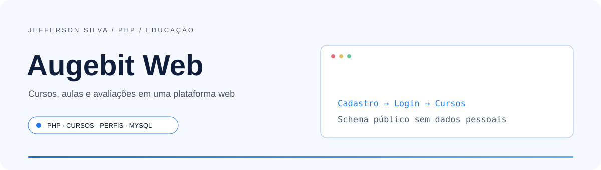
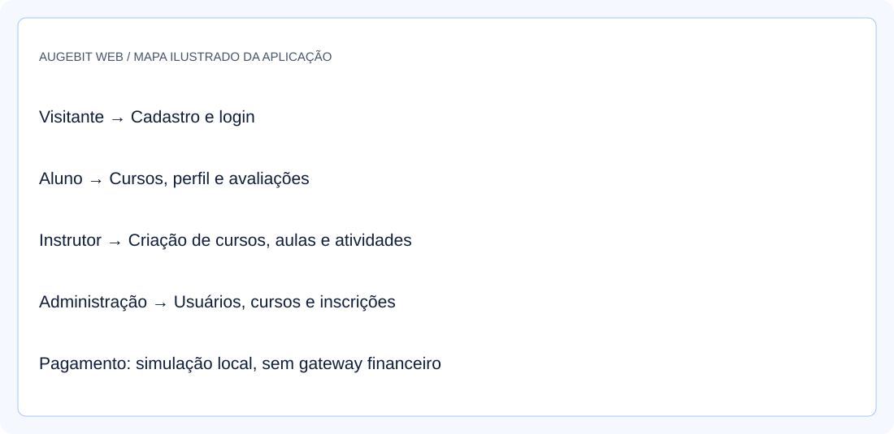
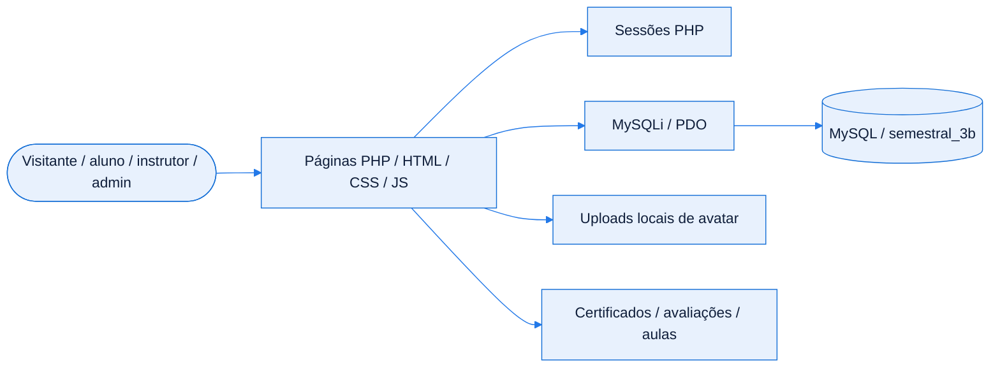
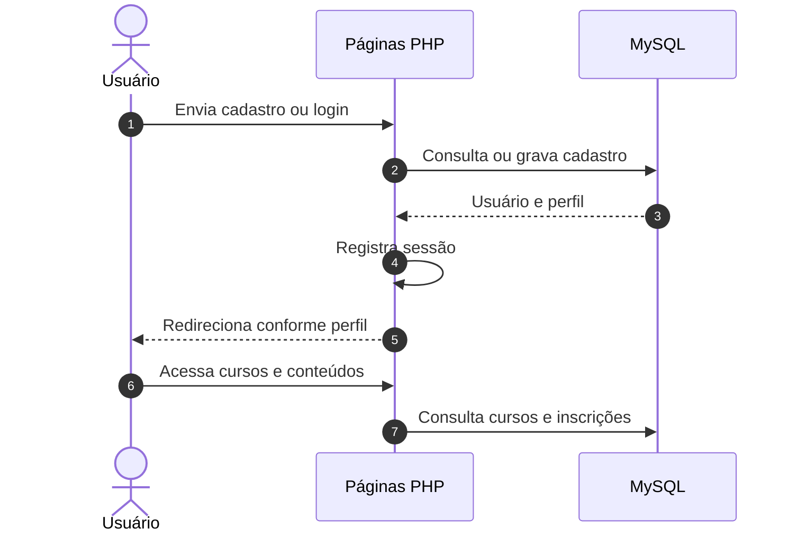
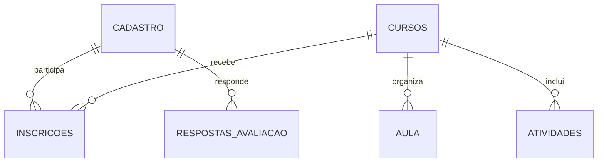

<!-- Jefferson Silva / README 4.0 — adaptado ao código de Augebit Web. -->

<div align="center">

<picture>
  <source media="(prefers-color-scheme: dark)" srcset="./assets/banner-dark.svg" />
  <source media="(prefers-color-scheme: light)" srcset="./assets/banner-light.svg" />
  
</picture>

<br />
<br />

**Plataforma de cursos em PHP com perfis de aluno, instrutor e administração.**

<p>
  <a href="#inicio-rapido"></a>
  <a href="https://github.com/jeffsilva03/augebitWeb/issues/new"></a>
</p>

[](https://github.com/jeffsilva03/augebitWeb/commits/)
[](https://github.com/jeffsilva03/augebitWeb)
[](https://github.com/jeffsilva03/augebitWeb)
[](https://github.com/jeffsilva03/augebitWeb/issues)
[](https://github.com/jeffsilva03/augebitWeb/stargazers)

<a href="#stack">
  <picture>
    <source media="(prefers-color-scheme: dark)" srcset="https://skillicons.dev/icons?i=php,mysql,html,css,js&theme=dark" />
    
  </picture>
</a>

<br />
<br />

<a href="#visao-geral">Visão geral</a> &nbsp;•&nbsp;
<a href="#demonstracao">Demonstração</a> &nbsp;•&nbsp;
<a href="#funcionalidades">Funcionalidades</a> &nbsp;•&nbsp;
<a href="#stack">Stack</a> &nbsp;•&nbsp;
<a href="#arquitetura">Arquitetura</a> &nbsp;•&nbsp;
<a href="#inicio-rapido">Instalação</a> &nbsp;•&nbsp;
<a href="#exemplos">Exemplos</a> &nbsp;•&nbsp;
<a href="#roadmap">Roadmap</a> &nbsp;•&nbsp;
<a href="#contribuir">Contribuir</a>

</div>

<br />

> [!NOTE]
> **Status:** Protótipo PHP com módulos implementados. Sintaxe, formulários públicos e schema vazio verificados; fluxos completos e autorização ainda precisam de validação.

<a id="visao-geral"></a>
## ✦ Visão geral

**Augebit Web** é uma plataforma de cursos desenvolvida em PHP, HTML, CSS e JavaScript, com persistência em MySQL/MariaDB. O repositório reúne cadastro e login, catálogo, perfil do usuário, painéis de administração e instrutor, aulas, atividades, avaliações e certificados. A etapa de pagamento é uma simulação local, sem gateway financeiro.

<table>
<tr>
<td width="33%" valign="top">

**🧩 Problema**

Organizar cursos e seus conteúdos para visitantes, alunos, instrutores e administradores.

</td>
<td width="33%" valign="top">

**🛠️ Solução**

Distribui páginas PHP por módulo, usando sessões e consultas ao banco para os fluxos.

</td>
<td width="33%" valign="top">

**📈 Resultado**

Protótipo com módulos de cursos e perfis, estrutura SQL preservada e dados pessoais retirados do dump público.

</td>
</tr>
</table>

<a id="demonstracao"></a>
## ◐ Demonstração

<div align="center">

<picture>
  <source media="(prefers-color-scheme: dark)" srcset="./assets/screenshot-dark.svg" />
  
</picture>

<sub>Mapa ilustrado dos módulos. Formulários públicos e sintaxe PHP conferidos; fluxos autenticados completos não foram exercitados.</sub>

</div>

<details>
<summary><b>▶ Ver o fluxo em ação</b></summary>

Siga o [Início rápido](#inicio-rapido) e os [Exemplos de uso](#exemplos). As ilustrações não são capturas de contas ou bancos pessoais.

</details>

<a id="funcionalidades"></a>
## ◈ Funcionalidades

<sub>✅ Implementado &nbsp; 🚧 Parcial &nbsp; 🗓️ Planejado</sub>

| Módulo | O que faz | Estado |
| :-- | :-- | :-- |
| **Conta e perfis** | Cadastro, login e redirecionamento por perfil | ✅ |
| **Cursos** | Catálogo, página de curso, aulas e inscrições | ✅ |
| **Instrutor** | Criação e edição de cursos, aulas e atividades | ✅ |
| **Administração** | Listagem e gerenciamento de usuários, cursos e inscrições | ✅ |
| **Aluno** | Perfil com avatar, avaliações e certificado | ✅ |
| **Pagamento** | Simulação que aprova o fluxo; não processa dinheiro | 🚧 |
| **Validação completa** | Requer banco configurado e revisão dos fluxos e permissões | 🚧 |

<details>
<summary><b>▶ Regras de negócio e validações</b></summary>

| Regra | Comportamento |
| :-- | :-- |
| Cadastro | Valida formato de e-mail e senha com ao menos seis caracteres |
| Senha | Grava `password_hash` e verifica com `password_verify` |
| Perfis | Código reconhece `usuario`, `usuarioGeral`, `instrutor` e `adm` |
| Inscrição simulada | Verifica sessão e vínculo existente antes de registrar inscrição |
| Avatar | Arquivos enviados pelo usuário ficam em pasta de uploads |
| Dados públicos | SQL sem usuários, contatos, newsletter, notas ou respostas individuais |

</details>

<a id="stack"></a>
## ⚙ Stack e decisões técnicas

| Camada | Tecnologia | Por que foi escolhida |
| :-- | :-- | :-- |
| Servidor | PHP | Sessões, formulários e renderização das páginas |
| Dados | MySQL / MariaDB | Cadastros, cursos, inscrições, aulas e avaliações |
| Acesso ao banco | MySQLi / PDO | Consultas preparadas em diversos fluxos |
| Interface | HTML / CSS / JavaScript | Layout, componentes e interações no navegador |
| Autenticação | Sessões PHP / password_hash | Estado de login e verificação de senha |
| Ambiente | XAMPP / PHP CLI | Ambiente local possível, sem build Node ou Composer versionado |

> [!TIP]
> A revisão usou PHP 8.2.12 e MariaDB 10.4.32. Há conexões de banco repetidas em diferentes pastas; não existe carregamento de `.env` implementado.

<a id="arquitetura"></a>
## ⬡ Arquitetura



<details>
<summary><b>▶ Responsabilidade de cada componente</b></summary>

| Componente | Responsabilidade |
| :-- | :-- |
| `registro/` | Cadastro, autenticação e logout |
| `paginaInicial/` / `listaCursos/` | Página inicial e catálogo |
| `painelADM/` | Usuários, cursos e inscrições |
| `painelInstrutor/` | Criação e gestão de conteúdo |
| `curso/usuario/paginaPerfil/` | Perfil e avatar do usuário |
| `curso/usuarioGeral/` | Inscrição e simulação de pagamento |
| `certificado/` | Página de certificado |
| `semestral_3b.sql` | Schema público sem registros |

</details>

<details>
<summary><b>▶ Fluxo principal passo a passo</b></summary>



</details>

<details>
<summary><b>▶ Modelo de dados</b></summary>



Diagrama conceitual, sem afirmar que todos os vínculos são chaves estrangeiras no SQL. São 13 tabelas, incluindo contato, newsletter, avaliações, conteúdos e módulos.

</details>

<a id="inicio-rapido"></a>
## ⚡ Início rápido

**Pré-requisitos**

| Ferramenta | Versão | Como verificar |
| :-- | :-- | :-- |
| PHP | 8.2.12 usado na revisão | `php --version` |
| Extensões PHP | MySQLi e PDO MySQL | `php -m` |
| MySQL / MariaDB | MariaDB 10.4.32 usado na revisão | `mysql --version` |
| Git | Versão recente | `git --version` |

<details open>
<summary><b>Windows · PowerShell</b></summary>

```powershell
git clone https://github.com/jeffsilva03/augebitWeb.git
cd augebitWeb
# Com PHP e MySQL no PATH, crie e importe um banco local novo:
mysql -u root -p
# CREATE DATABASE semestral_3b CHARACTER SET utf8mb4;
# USE semestral_3b;
# SOURCE C:/caminho/augebitWeb/semestral_3b.sql;
# EXIT;
# Confira os arquivos de conexão antes de iniciar.
php -S 127.0.0.1:8000 -t .
```

No XAMPP, os executáveis podem estar em `C:\xampp\php` e `C:\xampp\mysql\bin`; ajuste o PATH para executar os comandos.

</details>

<details>
<summary><b>▶ Linux / macOS</b></summary>

```bash
git clone https://github.com/jeffsilva03/augebitWeb.git
cd augebitWeb
mysql -u root -p -e "CREATE DATABASE semestral_3b CHARACTER SET utf8mb4;"
mysql -u root -p semestral_3b < semestral_3b.sql
# Ajuste as conexões ao banco local.
php -S 127.0.0.1:8000 -t .
```

Sequência documentada; não executada neste ambiente.

</details>

> [!TIP]
> Abra **http://127.0.0.1:8000/registro/form_login.php** ou **/registro/form_cadastro.php**. A página inicial está em **/paginaInicial/paginaInicial.php** e depende do banco configurado. O SQL não inclui contas ou cursos prontos.

**Variáveis de ambiente**

Não há leitor de `.env` no projeto. As configurações atuais estão nos arquivos PHP abaixo; não coloque credenciais reais em commits.

| Configuração | Obrigatória | Padrão | Local |
| :-- | :-- | :-- | :-- |
| Host / usuário / senha / banco | Sim | `localhost`, `root`, senha vazia, `semestral_3b` | `conexaoBD/conexao.php`, `arquivosReuso/conexao.php` e `curso/usuarioGeral/conexao.php` |
| Conexões do conteúdo | Sim | Valores locais no código | `painelInstrutor/conteudoCursos/conecta.php`, `conexao.php`, `aula.php` e `avaliacao.php` |
| Conexão PDO | Certificados | Valores locais no código | `certificado/cert.php` |

> [!IMPORTANT]
> O projeto já era público e continha dados de usuários e avatares. Esta mudança retira os registros atuais, mas o histórico continua contendo essas versões. O protótipo também precisa de revisão de autorização e uploads antes de receber dados reais.

<details>
<summary><b>▶ Problemas comuns</b></summary>

| Sintoma | Causa provável | Como resolver |
| :-- | :-- | :-- |
| Erro de conexão | Credenciais diferentes em arquivos repetidos | Ajuste todos os pontos de conexão para o banco local |
| Catálogo vazio | Schema público sem registros | Crie cursos fictícios no ambiente local |
| 404 ao abrir `/` | Não há index na raiz | Use o caminho explícito da página |
| MySQLi/PDO não encontrado | Extensão PHP desabilitada | Ative as extensões no ambiente local |
| Imagem de perfil antiga não aparece | Uploads pessoais foram retirados | Use o avatar padrão ou envie imagem fictícia localmente |

</details>

<a id="exemplos"></a>
## ◉ Exemplos de uso

<details open>
<summary><b>▶ Cenário principal</b></summary>

1. Importe a estrutura em um banco local novo.
2. Confira o cadastro e login usando somente dados fictícios.
3. Examine os painéis correspondentes aos perfis no código.
4. Cadastre conteúdo fictício para validar os fluxos de cursos, avaliações e inscrições.

Esta revisão conferiu os formulários públicos e a importação do schema; não certificou o ciclo completo de todos os perfis.

</details>

<details>
<summary><b>▶ Endpoints da aplicação</b></summary>

| Método | Rota | Descrição | Autenticação |
| :-- | :-- | :-- | :-- |
| `GET` | `/registro/form_login.php` | Formulário de login | — |
| `POST` | `/registro/autenticar.php` | Autentica por e-mail e senha | Credenciais |
| `GET`, `POST` | `/registro/form_cadastro.php`, `/registro/cadastrar.php` | Cadastro | Conforme fluxo existente |
| `GET` | `/listaCursos/listagemCursos.php` | Catálogo | Conforme página |
| `GET` | `/painelADM/painel_adm.php` | Administração | Sessão/perfil |
| `GET` | `/painelInstrutor/painel_instrutor.php` | Painel do instrutor | Sessão/perfil |
| `GET` | `/curso/usuario/paginaPerfil/pgnUser.php` | Perfil do aluno | Sessão |

São páginas PHP e formulários; o projeto não expõe um contrato REST/OpenAPI.

</details>

<details>
<summary><b>▶ Testes e qualidade</b></summary>

| Comando / verificação | O que faz |
| :-- | :-- |
| `php -l registro/autenticar.php` | Confere sintaxe de um arquivo |
| Lint de todos os PHP | 40 arquivos passaram na revisão |
| Importação SQL isolada | 13 tabelas criadas com zero registros |
| Verificação HTTP local | Formulários de login/cadastro e avatar padrão responderam 200 |

Não há suíte automatizada versionada. Confira o escopo em [Validação da documentação](./docs/validacao-readme.md).

</details>

<a id="roadmap"></a>
## ◇ Roadmap

- [x] Implementar módulos de conta, cursos e perfis
- [x] Preservar schema sem dados pessoais
- [x] Retirar avatares enviados por usuários e ignorar novos uploads
- [ ] Centralizar configuração do banco fora do código
- [ ] Revisar cadastro por perfil, autorização, CSRF e uploads
- [ ] Adicionar testes de fluxos com dados fictícios
- [ ] Tratar dados históricos antes de ampliar a divulgação

<sub>Os itens pendentes são sugestões de evolução, sem prazo definido. Acompanhe e sugira melhorias nas <a href="https://github.com/jeffsilva03/augebitWeb/issues">issues</a>.</sub>

<a id="documentacao"></a>
## ▤ Documentação

<details>
<summary><b>▶ Estrutura de pastas</b></summary>

```text
augebitWeb/
├── registro/                   # cadastro, login e logout
├── paginaInicial/              # página inicial
├── listaCursos/                # catálogo e curso
├── painelADM/                  # administração
├── painelInstrutor/            # cursos, aulas e avaliações
├── curso/                      # perfil, inscrição e pagamento simulado
├── certificado/
├── chat/
├── arquivosReuso/              # layouts, imagens e conexão
├── conexaoBD/
├── assets/                     # documentação nos dois temas
├── docs/                       # auditoria e validação
├── semestral_3b.sql             # somente estrutura
├── .gitignore
└── README.md
```

</details>

<details>
<summary><b>▶ Perguntas frequentes</b></summary>

**O pagamento cobra dinheiro?**
Não. O código simula aprovação e registra a inscrição, sem integração com adquirente ou gateway.

**Existem contas ou fotos pessoais para testar?**
Não na versão preparada. Use dados fictícios e o avatar padrão. Os registros antigos continuam no histórico.

**Posso configurar o banco por `.env`?**
Não diretamente. O código atual usa configurações PHP repetidas; a centralização está sugerida no roadmap.

**Existe licença de uso?**
Não há arquivo de licença; nenhuma licença foi presumida.

</details>

<details>
<summary><b>▶ Limitações e segurança</b></summary>

- **Limitações:** conexões duplicadas, caminhos relativos e validação incompleta dos fluxos autenticados nesta revisão.
- **Segurança:** seleção de perfis no cadastro, permissões, CSRF e uploads precisam de revisão antes de uso real.
- **Privacidade:** cadastros, contatos, newsletter, respostas e avatares foram retirados da versão atual; o histórico público ainda precisa de tratamento. Veja a [auditoria](./docs/auditoria-portfolio.md).
- **Reportar vulnerabilidade:** não publique dados pessoais ou hashes em issues; combine canal reservado com o responsável.

</details>

<a id="contribuir"></a>
## ⇄ Contribuir

1. Faça um fork e crie uma branch: `git checkout -b feat/minha-melhoria`
2. Faça commits seguindo o padrão abaixo
3. Rode `php -l registro/autenticar.php`, confira os fluxos alterados e execute os testes disponíveis antes de abrir o PR
4. Abra um Pull Request descrevendo o que mudou e por quê

<details>
<summary><b>▶ Padrão de commits</b></summary>

| Prefixo | Quando usar | Exemplo |
| :-- | :-- | :-- |
| `feat` | Nova funcionalidade | `feat: adiciona filtro por data` |
| `fix` | Correção de bug | `fix: corrige cálculo do total` |
| `docs` | Só documentação | `docs: atualiza instalação` |
| `refactor` | Mudança interna sem alterar comportamento | `refactor: separa serviço de e-mail` |
| `test` | Testes | `test: cobre fluxo de login` |
| `chore` | Configuração e manutenção | `chore: atualiza dependências` |

</details>

## ◎ Autor

<table>
<tr>
<td align="center" width="140">
  <a href="https://github.com/jeffsilva03"></a>
</td>
<td>

**Jefferson Silva**<br />
Portfólio · Augebit Web<br />
Projeto de cursos disponível no portfólio de Jefferson Silva.

<a href="https://github.com/jeffsilva03"></a>

</td>
</tr>
</table>

---

<div align="center">

Se este projeto foi útil, considere deixar uma ⭐ — isso ajuda outras pessoas a encontrá-lo.

<br />

<a href="#visao-geral"></a>

<sub>PHP &nbsp;•&nbsp; MySQL &nbsp;•&nbsp; Educação</sub>

</div>
